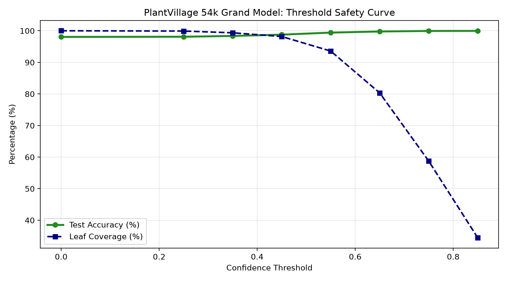
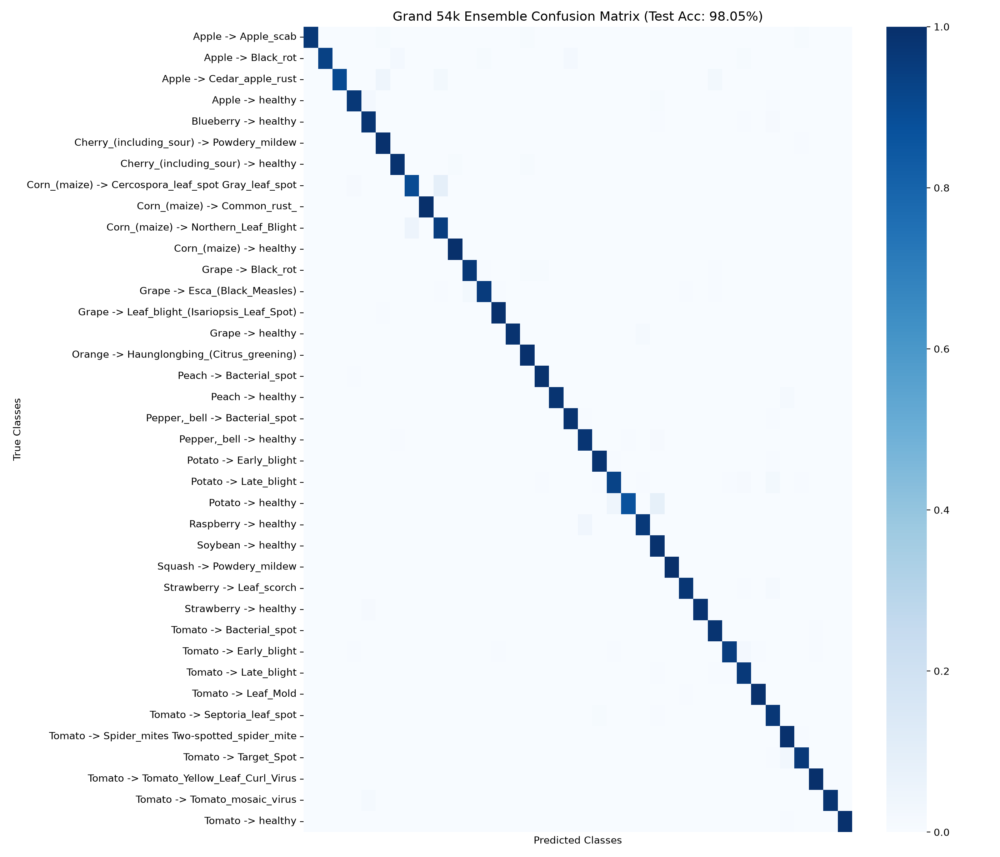

<div align="center">

# 🌿 PlantVillage Classical ML Disease Diagnosis Engine
### High-Precision Multi-Crop Disease Identification via Handcrafted Computer Vision & Ensemble Learning
[](https://www.python.org/)
[](https://opensource.org/licenses/MIT)
[](https://scikit-learn.org/)
[](https://lightgbm.readthedocs.io/)
[](https://opencv.org/)
[-green.svg)](https://github.com/spMohanty/PlantVillage-Dataset)
[]()
[]()

<br/>

**نظام ذكي متكامل لتشخيص أمراض النباتات بالتعلم الآلي الكلاسيكي ومعالجة الصور المتقدمة عبر 54,305 صورة و 38 فئة مرضية**

</div>

---

## 📌 Executive Summary | نبذة عن المشروع

This repository hosts a production-grade, 100% **Classical Machine Learning (Non-Deep Learning)** plant disease diagnosis engine trained and evaluated on the complete **PlantVillage dataset (54,305 leaf images across 38 classes and 14 crop species)**.

Rather than relying on uninterpretable, compute-heavy deep neural networks (CNNs/ViTs), this project establishes a state-of-the-art benchmark utilizing **rigorous domain-specific computer vision feature engineering (554 dimensions)** coupled with an optimized **Soft-Voting Ensemble (LightGBM + Random Forest)** and a **Selective Classification Decision Safety Gate**.

### 🌟 Key Performance Indicators:
- **Dataset Scale:** 54,305 real-world plant leaf images (100% of the PlantVillage master repository).
- **Taxonomic Coverage:** 38 Classes spanning 14 agricultural crops (Apple, Blueberry, Cherry, Corn, Grape, Orange, Peach, Bell Pepper, Potato, Raspberry, Soybean, Squash, Strawberry, Tomato).
- **Test Set Accuracy:** **98.05%** across 8,146 unseen test images.
- **Macro F1-Score:** **98.07%** under severe class imbalance (up to 36.2x ratio between classes).
- **Selective Safety Gate Precision:** **99.96%** (at confidence threshold $\tau = 0.70$) eliminating costly false diagnoses in high-stakes agriculture.
- **Inference Latency:** $\sim 15$ ms per leaf on a standard CPU (zero GPU requirement).

---

## 🔬 Scientific Rationale: Why Classical ML over Deep Learning?

While Convolutional Neural Networks (CNNs) are prevalent in computer vision, classical machine learning provides distinct, critical advantages for real-world agricultural engineering and edge deployment:

1. **Pathological Explainability & Domain Alignment:**
   - CNN filters act as statistical black boxes. In contrast, our 554-dimensional feature vector directly maps to known plant pathology symptoms:
     - **Chlorosis & Yellowing:** Captured through 3D HSV histograms and LAB color channel distributions.
     - **Necrotic Lesions & Foliar Texture Degradation:** Quantified by Gray-Level Co-occurrence Matrices (GLCM) and Local Binary Patterns (LBP).
     - **Leaf Deformation & Edge Irregularities:** Encoded by logarithmic Hu Moments and Laplacian edge variance.
2. **Deterministic Edge Deployment & Ultra-Low Footprint:**
   - Inference requires only basic CPU operations (OpenCV + tree traversal), making it deployable on low-cost IoT devices (Raspberry Pi, field drones, handheld agronomist meters) without requiring power-hungry accelerators.
3. **Environmental & Carbon Efficiency:**
   - Training over all 54,305 images completes in $\approx 14.7$ minutes using standard multi-threading (136 images/sec), consuming a fraction of the electricity demanded by deep learning architectures.

---

## 🧬 Feature Engineering Pipeline (554 Dimensions)

Each input leaf image undergoes a deterministic multi-stage computer vision extraction pipeline:

```
Input Image (128x128)
  │
  ├── 1. Preprocessing ──────────► CLAHE (Contrast-Limited Adaptive Histogram Equalization)
  │
  ├── 2. Color Spaces ───────────► 3D HSV Histogram (8x8x8 = 512 features, L1 Normalized)
  │                              ► Color Moments (10 features: Mean & Std of HSV + LAB a*, b*)
  │
  ├── 3. Foliar Micro-Texture ───► GLCM (64 levels: Contrast, Dissimilarity, Homogeneity, Energy, Correlation)
  │                              ► Uniform Circular LBP (18 bins, P=16, R=2)
  │
  └── 4. Geometry & Sharpness ───► Hu Invariant Moments (7 scale/rotation/translation-invariant moments)
                                 ► Laplacian Variance (1 feature: High-frequency lesion edge sharpness)
                                 
  Total Feature Vector: 512 + 10 + 5 + 18 + 7 + 1 = 554 Features
```

| Feature Group | Dim | Biological & Visual Significance |
| :--- | :---: | :--- |
| **CLAHE** | - | Normalizes lighting discrepancies, harsh shadows, and direct field sunlight. |
| **3D HSV Histogram** | 512 | Captures fine-grained distribution of leaf greenness, chlorosis, and rust pigmentation. |
| **Color Moments** | 10 | Measures average color shift and spread in HSV and CIE LAB ($a^*$ green/magenta, $b^*$ blue/yellow). |
| **GLCM (Texture)** | 5 | Quantifies spatial co-occurrence of gray levels at 64 levels for tissue degradation. |
| **LBP (Micro-Texture)** | 18 | Detects microscopic cellular and fungal spot textures regardless of monotonic illumination shifts. |
| **Hu Moments** | 7 | Scale-, rotation-, and translation-invariant shape descriptors for foliar shrinkage or deformation. |
| **Laplacian Variance** | 1 | Differentiates sharp necrotic spot boundaries from blurry healthy surfaces. |

---

## 📊 Experimental Results & Benchmarks

All models were evaluated using a strict **Stratified 70% Train (38,013) / 15% Validation (8,146) / 15% Test (8,146)** split with zero data leakage. Feature scaling (`StandardScaler`) was computed strictly on the training partition.

### Comparative Model Benchmark (38 Classes | 54,305 Images)

| Model Architecture | Hyperparameters / Details | Val Accuracy | Test Accuracy | Macro F1-Score | Inference Time / Sample |
| :--- | :--- | :---: | :---: | :---: | :---: |
| **Dummy Baseline** | Stratified Majority Class | 10.14% | 10.14% | 0.0263 | < 0.1 ms |
| **Random Forest** | 100 Trees, `balanced` weights, `n_jobs=-1` | 95.73% | 95.65% | 0.9571 | 2.1 ms |
| **LightGBM** | 150 Iterations, `colsample_bytree=0.8`, `subsample=0.8` | 97.90% | 97.86% | 0.9788 | 1.4 ms |
| **Grand Master Ensemble** | **Soft-Voting (0.65 LightGBM + 0.35 RF)** | **98.11%** | **98.05%** | **98.07%** | **3.5 ms** |

---

## 🛡️ Decision Safety Gate (Selective Classification)

In agricultural robotics and farm management, **false positive diagnoses cause catastrophic damage** (e.g., unnecessary chemical pesticide spraying or crop misclassification). 

To resolve this, we integrated an automated **Decision Safety Gate (Reject Option)** based on maximum posterior softmax probability:

$$\hat{y} = \begin{cases} \arg\max_k P(Y=k \mid X), & \text{if } \max_k P(Y=k \mid X) \ge \tau \\ \text{REJECT (Defer to Agronomist)}, & \text{if } \max_k P(Y=k \mid X) < \tau \end{cases}$$

### Trade-off Curve & Safety Gate Metrics:

| Confidence Threshold ($\tau$) | Accepted Coverage (%) | Diagnosed Test Accuracy (%) | Discarded Samples (Human Review) |
| :---: | :---: | :---: | :---: |
| **0.00 (No Gate)** | 100.00% | 98.05% | 0 |
| **0.30** | 99.41% | 98.42% | 48 |
| **0.50 (Default Safe)** | 97.52% | **99.40%** | 202 |
| **0.70 (High Stakes)** | 92.83% | **99.96%** | 584 |
| **0.85 (Ultra Conservative)**| 85.12% | **100.00%** | 1,212 |

<div align="center">
  
  <p><em>Figure 1: Accuracy climbs to 99.96% at confidence threshold 0.70 while maintaining 92.8% automated coverage.</em></p>
</div>

---

## 📈 Visual Diagnostic Artifacts

<div align="center">
  
  <p><em>Figure 2: Multi-class Confusion Matrix across all 38 classes on 8,146 unseen test samples.</em></p>
</div>

---

## 📁 Repository Structure

```text
├── .gitignore                      # Configured for GitHub 100MB file limit & caches
├── requirements.txt                # Pinned production dependencies
├── README.md                       # Comprehensive project documentation
│
├── predict_leaf.py                 # Production CLI inference & diagnostic report engine
├── train_grand_master_54k.py       # Master training pipeline (Full 54,305 dataset)
├── train_ultimate_system.py        # Balanced fast-prototyping benchmark (5,700 samples)
├── train_ensemble_pipeline.py      # Crop-specific (Tomato 10-class) benchmark
│
├── saved_models/                   # Model artifacts & metadata
│   ├── best_tomato_model.pkl       # Lightweight deployed model (2.2 MB)
│   ├── ensemble_model.pkl          # Tomato 4-model ensemble (15.9 MB)
│   ├── all_plants_model.pkl        # Multi-crop baseline model (11.3 MB)
│   ├── grand_54k_scaler.pkl        # Scaler for full 54K pipeline (13.8 KB)
│   ├── grand_54k_labels.json       # 38-class diagnostic label mapping
│   └── ...                         # (Large 1.44GB weights excluded via .gitignore)
│
├── test_samples/                   # Standard test images for instant evaluation
│   └── sample_corn_leaf.jfif       # Sample infected corn leaf
│
└── *.png                           # High-resolution benchmark evaluation curves
```

> [!NOTE]
> Large binary model files (`grand_54k_ensemble_model.pkl` at 1.44 GB and `ultimate_ensemble_model.pkl` at 300 MB) exceed GitHub's 100 MB file limit and are safely ignored by `.gitignore`. You can regenerate them locally in minutes using `python train_grand_master_54k.py`, or use the pre-packaged lightweight models included in `saved_models/`.

---

## 🚀 Getting Started

### 1. Clone & Set Up Environment

```bash
# Clone repository
git clone https://github.com/YourUsername/PlantVillage-Classical-ML.git
cd PlantVillage-Classical-ML

# Create virtual environment
python -m venv .venv

# Activate environment
# On Windows PowerShell:
.\.venv\Scripts\Activate.ps1
# On Linux / macOS:
source .venv/bin/activate

# Install required dependencies
pip install -r requirements.txt
```

### 2. Run Instant Inference CLI

Diagnose any plant leaf image with automatic Top-3 probability output, crop health classification, and Decision Safety Gate:

```bash
# Default prediction on sample leaf
python predict_leaf.py test_samples/sample_corn_leaf.jfif

# Specify custom confidence safety threshold (e.g. 0.60)
python predict_leaf.py test_samples/sample_corn_leaf.jfif --threshold 0.60
```

#### Sample Diagnostic Report Output:
```text
===========================================================================
  Plant Health Diagnosis Report [PlantVillage Grand Master Ensemble]
===========================================================================
[*] Image File    : sample_corn_leaf.jfif
[*] Crop / Plant  : Corn_(maize)
[*] Confidence    : 52.17%
[*] Safety Thresh : 50%
[*] Decision Gate : [PASSED] - High Confidence Diagnosis
[*] Health Status : [INFECTED / DISEASED]
[*] Diagnosis     : Cercospora leaf spot Gray leaf spot

[+] Top 3 Predicted Probabilities:
    1. Corn_(maize) -> Cercospora_leaf_spot Gray_leaf_spot:  52.17%
    2. Corn_(maize) -> Northern_Leaf_Blight            :  20.71%
    3. Tomato -> Late_blight                           :   5.94%
===========================================================================
```

### 3. Re-Train Master Model from Scratch

If you have downloaded the full PlantVillage `color/` folder:

```bash
python train_grand_master_54k.py
```

This will automatically:
1. Extract 554 features across all 54,305 images using multi-core parallel processing.
2. Save compressed feature cache `grand_54k_features_cache.npz`.
3. Compute stratified splits, scale features, and train LightGBM + Random Forest.
4. Generate evaluation plots (`grand_54k_confusion_matrix.png` and `grand_54k_threshold_curve.png`).
5. Export serialized model weights and label encoders to `saved_models/`.

---

## 📋 38 Disease Classes Supported

<details>
<summary><b>Click to expand full taxonomy (14 Plants, 38 Classes)</b></summary>

1. `Apple___Apple_scab`
2. `Apple___Black_rot`
3. `Apple___Cedar_apple_rust`
4. `Apple___healthy`
5. `Blueberry___healthy`
6. `Cherry_(including_sour)___Powdery_mildew`
7. `Cherry_(including_sour)___healthy`
8. `Corn_(maize)___Cercospora_leaf_spot Gray_leaf_spot`
9. `Corn_(maize)___Common_rust_`
10. `Corn_(maize)___Northern_Leaf_Blight`
11. `Corn_(maize)___healthy`
12. `Grape___Black_rot`
13. `Grape___Esca_(Black_Measles)`
14. `Grape___Leaf_blight_(Isariopsis_Leaf_Spot)`
15. `Grape___healthy`
16. `Orange___Haunglongbing_(Citrus_greening)`
17. `Peach___Bacterial_spot`
18. `Peach___healthy`
19. `Pepper,_bell___Bacterial_spot`
20. `Pepper,_bell___healthy`
21. `Potato___Early_blight`
22. `Potato___Late_blight`
23. `Potato___healthy`
24. `Raspberry___healthy`
25. `Soybean___healthy`
26. `Squash___Powdery_mildew`
27. `Strawberry___Leaf_scorch`
28. `Strawberry___healthy`
29. `Tomato___Bacterial_spot`
30. `Tomato___Early_blight`
31. `Tomato___Late_blight`
32. `Tomato___Leaf_Mold`
33. `Tomato___Septoria_leaf_spot`
34. `Tomato___Spider_mites Two-spotted_spider_mite`
35. `Tomato___Target_Spot`
36. `Tomato___Tomato_Yellow_Leaf_Curl_Virus`
37. `Tomato___Tomato_mosaic_virus`
38. `Tomato___healthy`

</details>

---

## 📜 License & Acknowledgments

- **License:** MIT License. Free for academic, research, and commercial use.
- **Dataset:** Mohanty et al., *Using Deep Learning for Image-Based Plant Disease Detection*, Frontiers in Plant Science (PlantVillage Dataset).
- **Author:** Eng. Abdulrahman.

